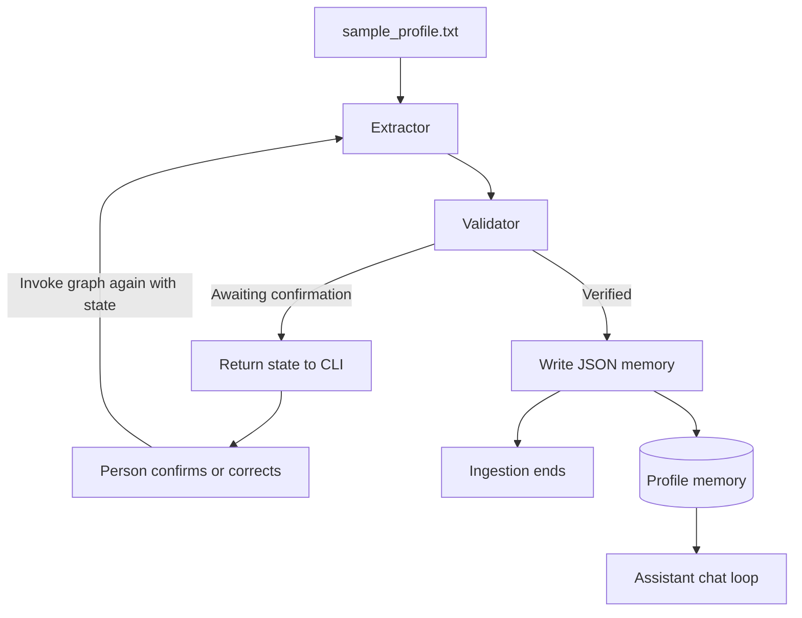

# agent-forge

**A command-line assistant that turns a free-form profile into human-confirmed memory for personalized chat.**

agent-forge separates profile extraction, human review, persistence, and chat into small Python components. LangGraph coordinates the ingestion workflow, while LangChain's Groq integration handles extraction and assistant responses. A person confirms or corrects the extracted profile before it is written to a local JSON file.

This is a single-user prototype. Its “agents” are workflow functions, not independent background workers. The ingestion graph finishes after saving the profile; the chat loop calls the assistant directly.

## Contents

- [What it does](#what-it-does)
- [Workflow](#workflow)
- [Setup](#setup)
- [Configuration](#configuration)
- [Using agent-forge](#using-agent-forge)
- [State and memory](#state-and-memory)
- [Repository map](#repository-map)
- [Validation](#validation)
- [Limitations](#limitations)

## What it does

| Component | Responsibility |
| --- | --- |
| Extractor | Sends profile text to Groq, extracts a JSON object from the response, and marks it as unverified. |
| Validator | Asks for confirmation once, accepts `yes`, or accepts a corrected dictionary literal. |
| Memory keeper | Writes a nonempty verified profile to a local JSON file. |
| Assistant | Reads that file and combines the profile with the current chat message. |
| CLI | Runs ingestion first, then starts a simple chat loop. |
| Graph renderer | Exports the ingestion graph as a PNG. |

The intended profile contains `name`, `education`, `skills`, and `experience`. The prompt describes this structure, but the application does not enforce a typed profile schema.

## Workflow



The second graph invocation re-enters the extractor, which skips extraction when `extracted_profile` already exists. The validator then processes the human response. This is an explicit CLI loop around graph execution, not a durable LangGraph interrupt/checkpoint workflow.

## Setup

### Requirements

- Python 3.11+ as a practical starting environment.
- A Groq API key and a model available to that account.
- Network access for LLM requests.

The requirements use minimum versions rather than a lockfile. Compatibility depends on the versions resolved during installation.

```bash
git clone https://github.com/quixoticalcoder/agent-forge.git
cd agent-forge
python3 -m venv .venv
source .venv/bin/activate
pip install -r requirements.txt
cp .env.example .env
```

On Windows PowerShell, activate with `.\.venv\Scripts\Activate.ps1`.

Edit `.env` and set both `GROQ_API_KEY` and `GROQ_MODEL_NAME`. Then run from the repository root:

```bash
python main.py
```

There is no web server, database, or Streamlit UI in the current implementation. Streamlit and pytest are listed dependencies, but the application does not expose a Streamlit entry point or include an existing test suite.

## Configuration

| Variable | Behavior |
| --- | --- |
| `GROQ_API_KEY` | Required by the Groq client. Loaded from the environment or `.env`. |
| `GROQ_MODEL_NAME` | Model identifier passed to `ChatGroq`. Set it explicitly to a model available to your account. |
| `MEMORY_FILE` | Optional shared path for profile writes and assistant reads. Defaults to `memory/profile_memory.json` under the repository root. |

The source fallback for an unset model variable is `mixtral-8x7b-32768`. This is an inherited configuration value, not a verified currently supported model. A blank value in `.env` must be replaced before using the app.

Clients are constructed when the agent modules are imported, with `temperature=0`. Configuration errors can therefore appear before the CLI prompt. A deterministic temperature setting does not guarantee identical model output.

The default memory path is portable across machines. If you override it with a relative path, it resolves relative to the process working directory. Both agents now use the same setting, and the memory keeper creates parent directories when needed.

## Using agent-forge

### 1. Provide a profile

Edit `sample_profile.txt`. The included sample describes an engineering student without naming a person. The CLI currently loads this filename directly; there is no command-line file-selection option.

Only include information you intend to send to the model provider. Extraction transmits the source profile, and chat transmits the saved profile together with each current message.

### 2. Review the extraction

The extractor prompts the model for this shape:

```json
{
  "name": null,
  "education": "Third-year engineering student",
  "skills": ["Python", "Machine Learning"],
  "experience": null
}
```

Its parser can recover an object from a Markdown code fence or surrounding text. Malformed JSON still raises an error.

At the confirmation prompt, enter either:

```text
yes
```

or a complete Python dictionary literal on one line:

```python
{'name': None, 'education': 'Engineering student', 'skills': ['Python'], 'experience': None}
```

Corrections use Python literal syntax, so write `None` rather than JSON `null`. The validator uses `ast.literal_eval`, not executable `eval`, and rejects non-dictionary or syntactically invalid input while keeping confirmation pending. The dictionary replaces the whole extracted profile rather than merging selected fields.

### 3. Chat with profile context

After verification, the CLI starts chat mode. Enter a message or type `exit` to quit.

The assistant rereads memory on each call. It supplies the profile and current message to Groq, but does not include previous chat turns. Persistent profile context is therefore distinct from conversational memory.

Each new `python main.py` run begins ingestion again. Confirming a new profile overwrites the existing memory file; profiles are not merged, versioned, or separated by user.

### Optional graph visualization

From the repository root:

```bash
python -m utils.save_graph_image
```

The output is `memory/langgraph_workflow.png`. The renderer uses LangGraph's Mermaid PNG method, which may require access to an external rendering service. Agent imports still initialize the Groq client, even though rendering does not intentionally invoke an LLM.

`langgraph.json` also maps the graph ID `agent-forge` to `graph/workflow.py:agent`. The repository does not include the LangGraph development-server CLI in its requirements; this configuration alone does not install or start a server.

## State and memory

| State field | Purpose |
| --- | --- |
| `messages` | Message sequence with LangGraph's `add_messages` reducer. |
| `raw_profile_text` | Source text supplied to extraction. |
| `extracted_profile` | Parsed but not yet verified dictionary. |
| `verified_profile` | Human-accepted or corrected dictionary. |
| `awaiting_confirmation` | Whether the CLI should ask for another human response. |
| `confirmation_requested` | Prevents repeating the initial confirmation question. |

`memory/profile_memory.json` starts as an empty object. The memory keeper writes only truthy profiles; an empty dictionary is not saved. The assistant uses an empty profile when the file is missing, but malformed JSON is not handled as a recoverable condition.

The memory file remains tracked in the repository, so running ingestion can create a Git change containing profile data. Review it before committing. For private use, configure `MEMORY_FILE` outside the checkout. No encryption, access control, atomic-write protection, or concurrent-user isolation is implemented.

## Repository map

```text
agent-forge/
├── main.py                    Ingestion followed by chat
├── sample_profile.txt         Neutral input example
├── requirements.txt
├── .env.example
├── langgraph.json             Optional graph-loader configuration
├── agents/
│   ├── extractor.py           Prompt and JSON parsing
│   ├── validator.py           Human confirmation and literal corrections
│   ├── memory_keeper.py       JSON persistence
│   └── assistant.py           Profile-aware single-turn chat
├── config/
│   ├── settings.py            Environment and memory location
│   └── system_prompts.py      Extraction, validation, assistant prompts
├── graph/
│   ├── state.py               TypedDict state and message reducer
│   └── workflow.py            Graph construction and compiled export
├── llm/groq_llm.py            ChatGroq factory
├── memory/
│   ├── profile_memory.json
│   └── langgraph_workflow.png
└── utils/
    ├── cli_loader.py          Terminal interaction loops
    ├── file_loader.py         UTF-8 text loading
    └── save_graph_image.py    Workflow image generation
```

## Validation

Basic checks:

```bash
python -m pip check
python -m compileall -q agents config graph llm utils main.py
```

A meaningful isolated workflow check should replace the extractor and assistant LLM calls, invoke the graph until confirmation is requested, accept or correct the profile, and verify a temporary memory file. Verify that invalid corrections stay pending and that assistant reads use the same file.

Mocked checks establish control flow and persistence, not provider connectivity or extraction quality. Live validation requires your configured Groq model and deliberately supplied test profiles.

## Limitations

- Profile fields and nested values are not validated against a strict schema. A valid dictionary literal can still contain values that cannot be serialized to JSON.
- LLM parsing, provider errors, malformed memory, and filesystem failures can terminate the CLI; retry and recovery flows are not implemented.
- Confirmation state is held by the running process. There is no checkpointer or resume-after-restart mechanism.
- Chat includes only the latest message and stored profile, not prior conversation turns.
- Personalization uses plain prompt concatenation; user/profile text is not isolated from instructions in a structured message boundary.
- The application does not provide multiple profiles, authentication, memory history, or background execution.
- The graph and chat roles are separate; the assistant function is imported by the workflow module but is not a graph node.

## Contributing and license

Use `agent-forge` consistently in documentation and project-facing configuration. Keep changes focused on extraction, review, persistence, or chat, and test failure paths as well as successful confirmation.

No project-wide license file is included. The previous educational-use description does not establish redistribution permissions; consult the repository owner before reuse.
